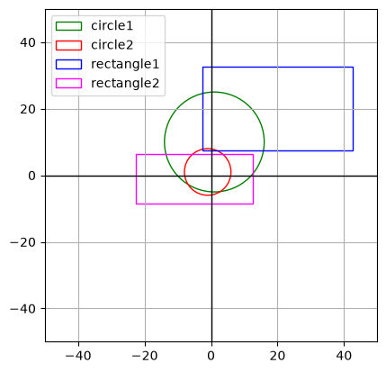

# Lab2_AIU26 - 2d and 3d shapes
A pythonlibrary to create, move, compare and plott geometrical shapes. Create, move and compare also works for cubes and spheres.

---
## Shapes and functions:
Circle: radius, area, perimeter and position.
Rectangle: width, height, area, perimeter and position.
Cube: side length and volume.
Sphere: radius and volume.
Translate: move object by inputing distances.
Shape2dPlotter: plott 2d shapes.

---
## Installation
Import needed functions from library by using:
"from lab2_aiu26 import" and your needed funtions (Circle, Rectangle, Cube, Sphere, Shape2dPlotter).
### Needed installs:
uv
matplotlib

## Use of functions - examples
### Create shape
- Rectangle: 
    rectangle1 = Rectangle(1,1,1,1) #(widht, height, x, y) position automaticly set to (0,0)
- Circle: 
    circle1 = Circle(5, 5, 5) #(radius, x, y) position automaticly set to (0,0)
- Cube: 
    cube1 = Cube(4, 4, 4, 4) #(side length, x, y, z) position automaticly set to (0,0,0)
- Sphere: 
    sphere1 = Sphere(2, 2, 2, 2) #(radius, x, y, z) position automaticly set to (0,0)

### Move shape - translate
- rectangle1.translate(1, 2) #Moves rectangle +1 on x and 2 on y
- cube1.translate(1, 2, 3) #Moves rectangle +1 on X and 2 on Y and 3 on Z

### Compare shapes
__eq__ (==):
Compares side_length/radius/(width & height) to check if two shapes are equal. Also checks so the shapes are the same. 

__lt__ (<):
Compares area/volume to check if first shape is smaller then the other.

__gt__ (>):
Compares area/volume to check if first shape is bigger then the other.

__ge__ (>=):
compares area/volume to check if first shape is bigger or equal to the other.

__le__ (<=):
Compares area/volume to check if first shape is smaller or equal to the other.
### Usage of compare - example
print(rectangle1 == rectangle2)
print(cube1 >= cube2)

### Plotting - only for rectangle and circle

plotter = Shape2dPlotter()
plotter.add_circle(circle1, label="circle1", color="green")
plotter.add_circle(circle2, label="circle2", color="red")
plotter.add_rectangle(rectangle1, label="rectangle1", color="blue")
plotter.add_rectangle(rectangle2, label="rectangle2", color="magenta")

plotter.ax.set_xlim(-50, 50)
plotter.ax.set_ylim(-50, 50)

plotter.show()

### Error handling
- for x,y,z only numbers are accepted. "five" will raise an error.
- for width, height, radius and side_length, only positive numbers will be accepted. "-5" and "Five" will raise an error.

